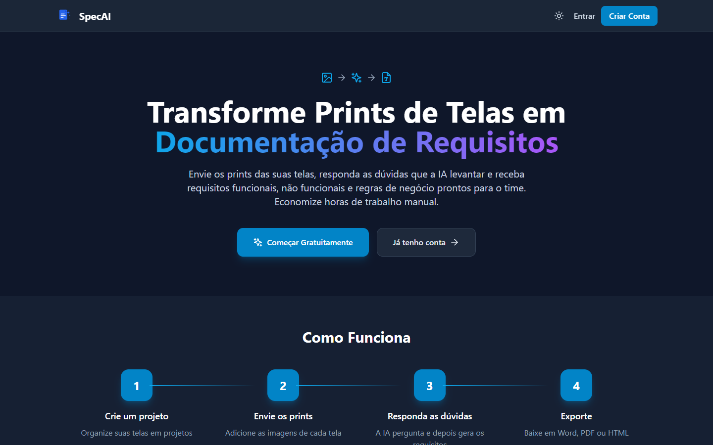
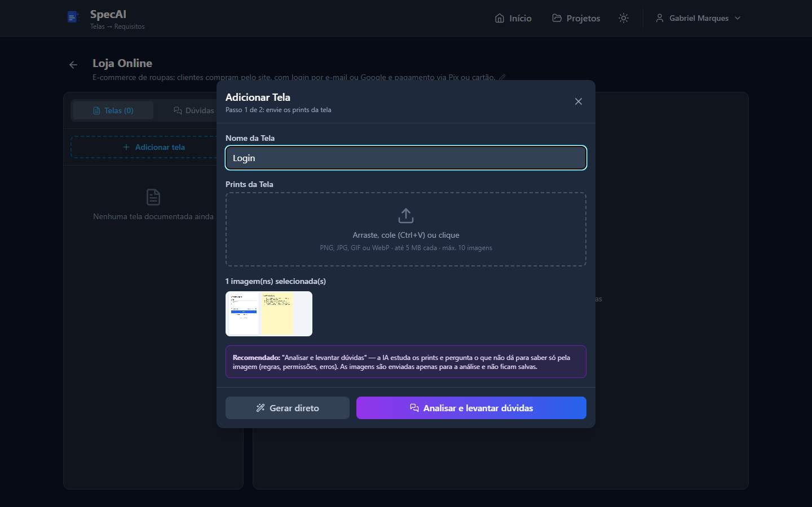
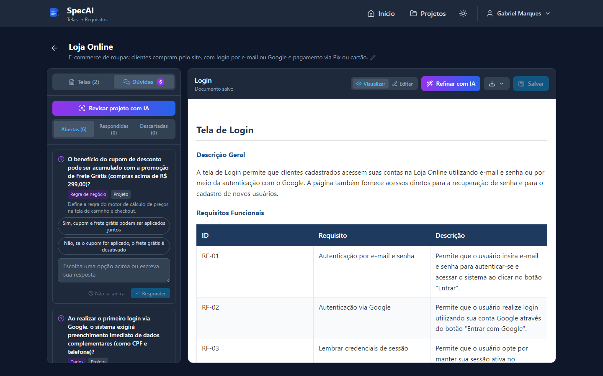
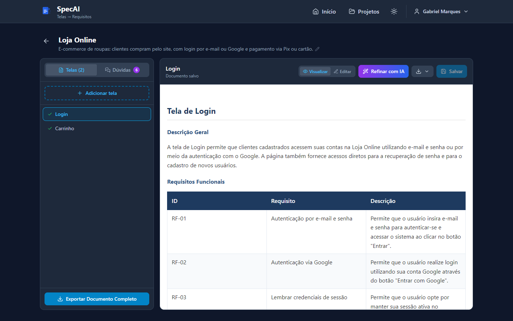
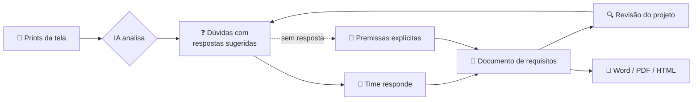
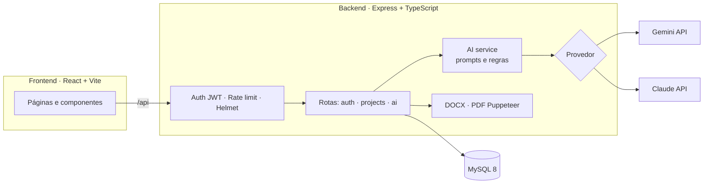

<div align="center">


# SpecAI

**Transforme prints de telas em documentação de requisitos — com uma IA que pergunta antes de escrever.**

[](https://react.dev)
[](https://www.typescriptlang.org)
[](https://nodejs.org)
[](https://expressjs.com)
[](https://www.mysql.com)
[](https://tailwindcss.com)
[](#-decisões-técnicas)
[](LICENSE)



</div>

---

## 💡 O problema

Em times Scrum, transformar o protótipo de uma tela em requisitos detalhados é um trabalho manual, repetitivo e fácil de errar. Ferramentas de IA ajudam a escrever, mas **inventam o que o print não mostra**: o que acontece quando a senha está errada? Quem pode acessar essa tela? O cupom acumula com frete grátis?

## ✨ A solução

O **SpecAI** lê os prints das telas e, **antes de escrever qualquer requisito, levanta as dúvidas que a imagem não responde**. O time responde com um clique (a IA já sugere as respostas prováveis) e o documento é gerado com essas decisões. O que fica sem resposta não é inventado: entra no documento como **premissa explícita**.

<table>
  <tr>
    <td width="50%"></td>
    <td width="50%"></td>
  </tr>
  <tr>
    <td align="center"><b>1. Envie os prints</b><br/><sub>Arraste, cole (Ctrl+V) ou selecione — várias imagens por tela</sub></td>
    <td align="center"><b>2. Responda as dúvidas da IA</b><br/><sub>Perguntas sobre regras, fluxos e permissões, com respostas sugeridas</sub></td>
  </tr>
</table>

<div align="center">
  
  <br/><b>3. Revise, edite e exporte</b> — RF, RNF e regras de negócio em tabelas, prontos para Word ou PDF
</div>

## 🚀 Funcionalidades

| | Funcionalidade | Descrição |
|---|---|---|
| ❓ | **Dúvidas antes de escrever** | A IA analisa os prints e pergunta o que não dá para inferir: regras implícitas, estados de erro, permissões, integrações |
| 📝 | **Geração de requisitos** | Requisitos funcionais, não funcionais e regras de negócio em tabelas, com IDs (RF-01, RNF-01, RN-01) |
| 📌 | **Quadro de regras** | Se o print tiver um quadro "Regras de negócio", a IA extrai e classifica cada regra, incluindo as mensagens do sistema |
| 🔍 | **Revisão do projeto** | A IA lê todas as telas salvas e aponta contradições, lacunas e fluxos não documentados entre elas |
| 🪄 | **Refinar com IA** | Atualiza um documento salvo com as respostas novas, preservando os IDs existentes |
| ✏️ | **Editor rico** | Edição visual com suporte a tabelas (TinyMCE) e pré-visualização isolada |
| 📄 | **Exportação** | Documento completo (com capa, sumário e numeração) ou tela individual em Word, PDF ou HTML |
| 🔐 | **Contas de usuário** | Cadastro, login, troca de senha e redefinição por link de uso único enviado por email |

## 🔄 Como funciona



As respostas ficam salvas no projeto e valem para **todas as telas seguintes**: decisões tomadas uma vez (ex.: "a sessão dura 30 dias") não precisam ser repetidas.

## 🏗️ Arquitetura



```
scrum-docs-generator/
├── backend/src/
│   ├── config.ts               # Variáveis de ambiente validadas na inicialização
│   ├── database/               # Pool MySQL e migrations idempotentes
│   ├── middleware/             # Autenticação, posse do projeto, rate limit, erros
│   ├── routes/                 # auth · projects · ai
│   ├── services/
│   │   ├── ai.service.ts       # Prompts e regras da IA (independente do provedor)
│   │   ├── ai/                 # Provedores: gemini.provider.ts · anthropic.provider.ts
│   │   ├── document-builder.ts # Documento combinado com capa, sumário e numeração
│   │   └── document.service.ts # Conversão para DOCX e PDF
│   └── utils/
├── frontend/src/
│   ├── components/project/     # Assistente de nova tela, painel de dúvidas, exportação
│   ├── pages/                  # Landing, projetos, editor, autenticação
│   └── services/               # Cliente HTTP
└── docker-compose.yml          # MySQL local
```

## 🧠 Decisões técnicas

- **IA independente de provedor.** Os prompts e regras ficam em um serviço único; cada provedor (Gemini, Claude) só implementa `generateText` e `generateJson`. Trocar de IA é uma variável de ambiente.
- **Saída estruturada e validada.** As dúvidas da IA voltam em JSON e são validadas com **Zod** antes de chegar ao banco — resposta malformada vira erro tratado, não dado corrompido.
- **Resiliência no plano gratuito.** Erros temporários (modelo sobrecarregado) têm novas tentativas com espera crescente; quando a cota diária do modelo principal acaba, o app passa automaticamente para um modelo alternativo.
- **Imagens não são armazenadas.** Os prints vão direto para a IA e são descartados — nada de upload em disco.
- **Documento combinado robusto.** O sumário e a numeração (2.1, 2.2…) são gerados a partir dos títulos reais de cada tela, não de regex sobre o texto da IA.

## 🛡️ Segurança

- **Autorização por recurso:** todo acesso a projeto passa por um middleware que verifica o dono; consultas de edição e exclusão também filtram pelo projeto (proteção contra IDOR).
- **Autenticação:** JWT com segredo obrigatório em produção e senhas com bcrypt (12 rounds); o login leva o mesmo tempo para emails existentes ou não, sem revelar quem é cadastrado.
- **Recuperação de senha:** link de uso único (token aleatório guardado como hash SHA-256) que expira em 1 hora — a senha atual só muda quando o link é usado.
- **Geração de PDF isolada:** o HTML é renderizado com JavaScript desativado e todas as requisições de rede bloqueadas (sem SSRF).
- **Conteúdo da IA:** sanitizado antes de salvar e exibido em `iframe` com `sandbox`.
- **Proteções gerais:** rate limit em login e nas chamadas de IA, Helmet, CORS restrito, limites de tamanho por rota e erros sem detalhes internos.

## 🛠️ Tecnologias

| Camada | Tecnologias |
|---|---|
| **Frontend** | React 18 · TypeScript · Vite · Tailwind CSS · TinyMCE · React Router · Axios |
| **Backend** | Node.js 22 · Express · TypeScript · Zod · JWT · bcrypt · Helmet · express-rate-limit |
| **IA** | Google Gemini (padrão, plano gratuito) · Anthropic Claude (opcional) |
| **Documentos** | docx (Word) · Puppeteer (PDF) |
| **Dados** | MySQL 8 (Docker Compose) |
| **Email** | Resend |

## ⚙️ Rodando localmente

**Pré-requisitos:** [Node.js 22+](https://nodejs.org), [Docker Desktop](https://www.docker.com/products/docker-desktop) e uma chave gratuita do [Google AI Studio](https://aistudio.google.com/apikey).

```bash
# 1. Instale as dependências (raiz, backend e frontend)
npm run setup

# 2. Configure o backend
cp backend/.env.example backend/.env
#    → cole sua GEMINI_API_KEY
#    → gere um JWT_SECRET: node -e "console.log(require('crypto').randomBytes(48).toString('hex'))"

# 3. Suba tudo (MySQL no Docker + backend + frontend)
npm run dev
```

Pronto: acesse **http://localhost:3000**. As tabelas do banco são criadas automaticamente na primeira execução.

| Comando | Descrição |
|---|---|
| `npm run dev` | MySQL + backend + frontend com hot reload |
| `npm run db:up` · `npm run db:down` | Inicia / para só o banco |
| `npm run db:logs` | Logs do MySQL |
| `npm run build` | Build de produção dos dois projetos |

<details>
<summary><b>Variáveis de ambiente do backend</b></summary>

| Variável | Obrigatória | Descrição |
|---|---|---|
| `GEMINI_API_KEY` | Sim (padrão) | Chave gratuita do [Google AI Studio](https://aistudio.google.com/apikey) |
| `GEMINI_MODEL` | Não | Modelo principal (padrão: `gemini-3.5-flash`) |
| `GEMINI_FALLBACK_MODEL` | Não | Usado quando a cota do principal acaba (padrão: `gemini-flash-lite-latest`; vazio desativa) |
| `AI_PROVIDER` | Não | `gemini` (padrão) ou `anthropic` |
| `ANTHROPIC_API_KEY` · `ANTHROPIC_MODEL` | Com `anthropic` | Chave e modelo do Claude (padrão: `claude-opus-5-5`) |
| `JWT_SECRET` | Em produção | Mínimo de 32 caracteres. Em dev, sem ele, é gerado um segredo aleatório por execução |
| `FRONTEND_URL` | Em produção | Origens liberadas no CORS (separadas por vírgula); a primeira é usada nos links de email |
| `DB_*` ou `DATABASE_URL` | Sim | Conexão MySQL (os valores do `.env.example` já batem com o `docker-compose.yml`) |
| `RESEND_API_KEY` · `RESEND_FROM_EMAIL` | Não | Envio de email. Sem eles, o link de redefinição de senha aparece no terminal |

</details>

<details>
<summary><b>Limites do plano gratuito do Gemini</b></summary>

O plano gratuito limita pedidos por modelo, por minuto e por dia (no `gemini-3.5-flash`, cerca de 20 por dia). Cada análise, geração, revisão ou refinamento conta como um pedido. Quando a cota do modelo principal acaba, o app usa automaticamente o modelo alternativo, que tem cota própria. Os limites da sua conta aparecem em [ai.dev/rate-limit](https://ai.dev/rate-limit).

</details>

## 📡 API

Todas as rotas, exceto `/api/auth/*` e `/api/health`, exigem `Authorization: Bearer <token>`. Em desenvolvimento, a documentação Swagger fica em `http://localhost:3001/api-docs`.

<details>
<summary><b>Autenticação</b></summary>

| Método | Endpoint | Descrição |
|---|---|---|
| `POST` | `/api/auth/register` | Cadastro |
| `POST` | `/api/auth/login` | Login |
| `GET` | `/api/auth/me` | Dados do usuário |
| `POST` | `/api/auth/change-password` | Alterar senha (logado) |
| `POST` | `/api/auth/forgot-password` | Envia link de redefinição |
| `POST` | `/api/auth/reset-password` | Define nova senha com o token do link |

</details>

<details>
<summary><b>Projetos e documentos</b></summary>

| Método | Endpoint | Descrição |
|---|---|---|
| `GET` · `POST` | `/api/projects` | Listar / criar projetos |
| `GET` · `PATCH` · `DELETE` | `/api/projects/:id` | Detalhes / editar nome e descrição / excluir |
| `GET` · `POST` | `/api/projects/:id/requirements` | Listar / salvar o documento de uma tela |
| `PUT` · `DELETE` | `/api/projects/:id/requirements/:reqId` | Atualizar / excluir documento |
| `GET` | `/api/projects/:id/export?format=docx\|pdf\|html` | Documento completo |
| `POST` | `/api/projects/:id/export-single` | Exporta o documento aberto no editor |

</details>

<details>
<summary><b>Inteligência artificial</b></summary>

| Método | Endpoint | Descrição |
|---|---|---|
| `GET` | `/api/projects/:id/ai/config` | Limites do provedor configurado |
| `POST` | `/api/projects/:id/ai/questions/screen` | Analisa prints e levanta dúvidas da tela |
| `POST` | `/api/projects/:id/ai/generate` | Gera os requisitos da tela (aceita respostas no mesmo envio) |
| `POST` | `/api/projects/:id/ai/refine` | Atualiza um documento salvo com as respostas |
| `POST` | `/api/projects/:id/ai/questions/review` | Revisa o projeto inteiro e levanta dúvidas gerais |
| `GET` | `/api/projects/:id/ai/questions` | Lista as dúvidas do projeto |
| `PATCH` · `DELETE` | `/api/projects/:id/ai/questions/:questionId` | Responder, descartar ou reabrir / excluir |

</details>

## 🗺️ Próximos passos

- [ ] Testes automatizados (API e componentes)
- [ ] Importar telas direto do Figma
- [ ] Histórico de versões dos documentos
- [ ] Exportar requisitos como issues/histórias de usuário

## 👤 Autor

**Gabriel Marques** — [GitHub @0GabrielMarques0](https://github.com/0GabrielMarques0)

## 📄 Licença

Distribuído sob a licença MIT. Veja [LICENSE](LICENSE) para mais detalhes.
